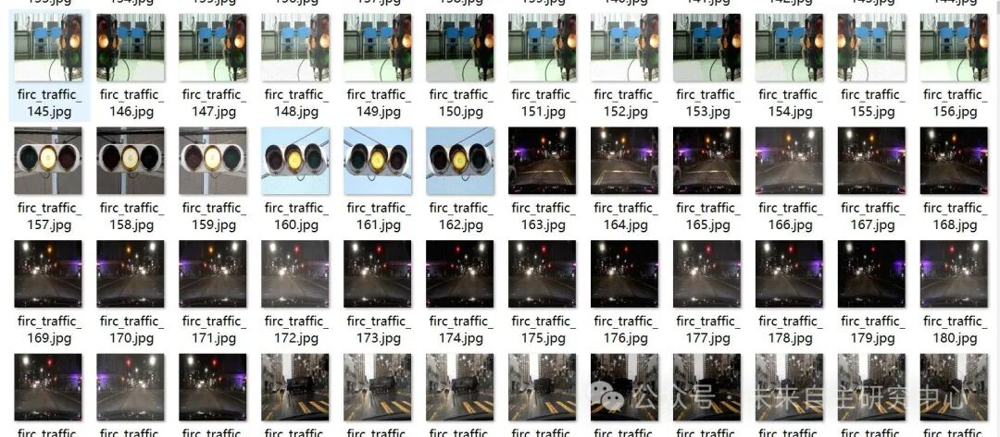
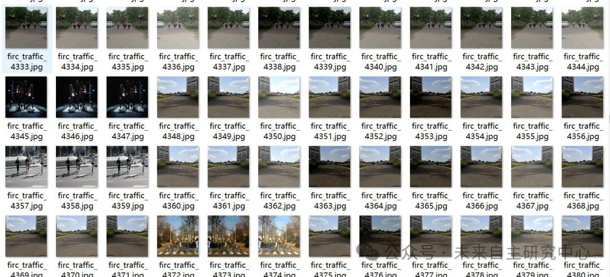
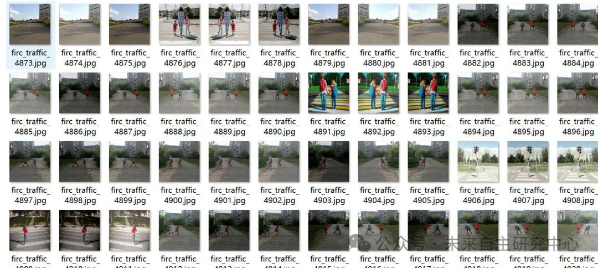
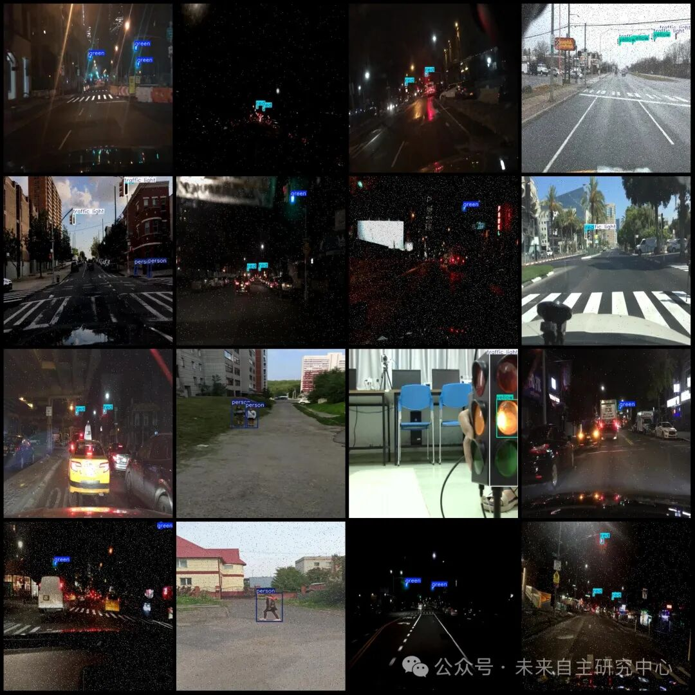

# Pedestrians Crossing Red Light Detection Dataset VOC+YOLO format with 9843 images in 5 categories

Some of the datasets have enhanced images, mainly salt and pepper noise enhancement. The original image is approximately one-third. Note that this includes the annotation of people and traffic lights. To implement the detection of red light running, one needs to write logic code themselves.

The dataset includes some enhanced images, mainly salt and pepper noise enhancement. The original images account for about one-third. Note that this involves labeling people and traffic lights. To implement the detection of pedestrians crossing red lights, one needs to write logic code themselves. For example, you can train a model using this dataset, then write code to define the pedestrian crosswalk area, while the camera is aimed at the crosswalk and traffic lights. When the area is detected to have people present and it's a red light, it can be determined that the pedestrian has crossed the red light.

Dataset format: Pascal VOC format + YOLO format (txt file without split path, only containing jpg images and corresponding VOC format xml files and yolo format txt files)

Number of images (number of jpg files): 9843

Number of annotations (number of xml files): 9843

Number of annotations (number of txt files): 9843

Label category count: 5

Label category names (note that the order of categories in the YOLO format does not correspond to this, but is based on the labels folder's classes.txt): ["green", "person", "red", "traffic light", "yellow"]

Number of boxes labeled in each category:

Green box count = 6116

Person Frames = 9740

Red Frame Count = 5376

Traffic light frame count = 3135

Number of yellow frames = 1523

Total frame count: 25890

Using labelImg:

Annotation rules: Draw a rectangle around the category.

Important Notice: No

Special : This dataset does not guarantee the accuracy or precision of the trained models or weight files. The dataset is provided with accurate and reasonable annotations only.

Image Preview:

Annotation example:

## Payment

Here is a pay link on Stripe ( https://buy.stripe.com/3cs8yP7sY87d0vu9AB ). Please contact me lonlonago@foxmail.com after funding $89, and I will send you a complete data files , thank you!

